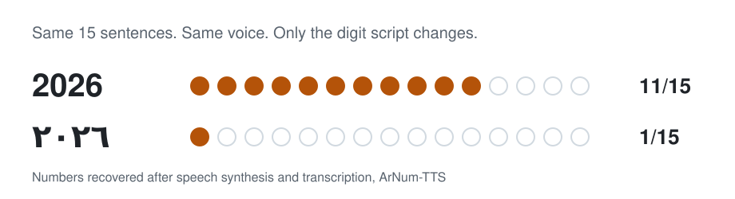

# Syamjith NK

**I measure things that look right and aren't.** Arabic that reads perfectly and is broken underneath. AI video that looks fine and never made the camera move it was asked for.

Independent AI researcher and developer in Abu Dhabi, with a background in cinematography.

[Website](https://syamjithnk.com) · [Research](https://syamjithnk.com/research) · [Evidence](https://syamjithnk.com/evidence) · [Hugging Face](https://huggingface.co/syamjithnk) · [Writing](https://syamjith-nk.github.io)

<a href="https://huggingface.co/datasets/syamjithnk/arnum-tts">
  <picture>
    <source media="(prefers-color-scheme: dark)" srcset="assets/hero-dark.svg">
    
  </picture>
</a>

### Tools

| | What it does | |
|---|---|---|
| [**arabic-lint**](https://github.com/Syamjith-NK/arabic-lint) | Finds Arabic corrupted before it was stored, and source code that will corrupt it. Zero dependencies, CI-ready. [Try it in the browser](https://huggingface.co/spaces/syamjithnk/arabic-lint). | `pip install arabic-lint` |
| [**shotdrift**](https://github.com/Syamjith-NK/shotdrift) | Checks whether a video made the camera move it was asked for, from pixels alone. [ComfyUI nodes](https://github.com/Syamjith-NK/shotdrift-comfyui). | `pip install shotdrift` |
| [**arabic-tts-frontend**](https://github.com/Syamjith-NK/arabic-tts-frontend) | Turns numerals, dates and currency into spoken Arabic before synthesis. Arabic-Indic digits went from 0/15 to 11/15 on the same engine. | `pip install arabic-tts-frontend` |

### Merged and shipped upstream

| Project | Contribution | Status |
|---|---|---|
| **pypdf** | [#4077](https://github.com/py-pdf/pypdf/pull/4077): Arabic-Indic digits now extract in the right order | Merged, released in [6.19.0](https://github.com/py-pdf/pypdf/releases/tag/6.19.0) |
| **matplotlib** | [#32263](https://github.com/matplotlib/matplotlib/pull/32263): upgrade guidance for Arabic text in 3.11 (documentation) | Merged |
| **SentencePiece** | [#1331](https://github.com/google/sentencepiece/issues/1331): reported a gap in bidi-control normalisation. The [fix](https://github.com/google/sentencepiece/commit/c9e4719b27eba6848d6d525ff5e73ef101027ab3) is the maintainer's | Fixed, in [v0.2.3](https://github.com/google/sentencepiece/releases/tag/v0.2.3) |
| **Stack Overflow** | [Accepted answer](https://stackoverflow.com/a/80001368) on right-to-left text in Matplotlib | Question viewed 15,000+ times |

### Open datasets and papers

| | Question | Result |
|---|---|---|
| [**OCR Numeral Fidelity**](https://huggingface.co/datasets/syamjithnk/ocr-numeral-fidelity) | Does OCR keep both the value and the script of a number? | 41 of 1,500 non-Western core trials kept both, neutral prompt. [Preprint](https://doi.org/10.5281/zenodo.23249467), not peer reviewed |
| [**Arabic Corpus Audit**](https://huggingface.co/datasets/syamjithnk/arabic-corpus-audit) | Is public Arabic training data corrupted? | Of 341 datasets, 276 were readable and about 240 scanned in Arabic; 21 had findings, mostly stray glyphs. [DOI](https://doi.org/10.5281/zenodo.22733934) |
| [**ArNum-TTS**](https://huggingface.co/datasets/syamjithnk/arnum-tts) | Do numbers survive Arabic speech synthesis? | One engine: 11/15 with `2026`, 1/15 with `٢٠٢٦` |
| [**ArShape**](https://huggingface.co/datasets/syamjithnk/arshape) | Does the usual rendering recipe still work? | On a renderer that already shapes: 15/15 without it, 0/15 with it |
| [**ArPDF**](https://huggingface.co/datasets/syamjithnk/arpdf) | Does Arabic survive a PDF round trip? | It depends on the generator and extractor pair, not on either tool |

These are small, controlled tests. Each one ships its raw results and says what it does not prove.

### How I work

I design the test so it can prove me wrong, and publish corrections with the old and new figures side by side. When my own scorer turned out to be faulty, [the fix and the changed numbers](https://huggingface.co/datasets/syamjithnk/arnum-tts#corrections) went out together. In shotdrift, checks that failed on real footage were [removed, not tuned](https://github.com/Syamjith-NK/shotdrift).

Also built: a real-time [Gulf Arabic voice agent](https://github.com/Syamjith-NK/arabic-voice-agent) on streaming speech recognition.
